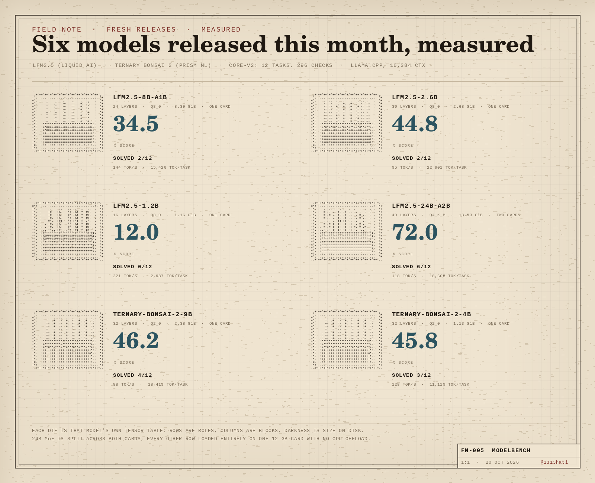

# Fresh releases, October 2026

Six models new to Hugging Face in the first half of October, run through
`core-v2` on the same two-card rig as the [twelve-gigabyte panel](../bench-2026-10-19-12gb/).
Five of six load entirely on one 12 GB card; the 24B MoE is split across both.

| model | vendor | quant | weights | placement | score | solved | tok/s | tok/task |
|---|---|---:|---:|---|---:|---:|---:|---:|
| [LFM2.5-24B-A2B](plates/) | Liquid AI | Q4_K_M | 14.53 GiB | both cards | 72.0% | 6/12 | 118.2 | 18,665 |
| [Ternary-Bonsai-2-9B](plates/) | Prism ML | Q2_0 | 2.56 GiB | one card | 46.2% | 4/12 | 88.2 | 18,419 |
| [Ternary-Bonsai-2-4B](plates/) | Prism ML | Q2_0 | 1.21 GiB | one card | 45.8% | 3/12 | 128.2 | 11,119 |
| [LFM2.5-2.6B](plates/) | Liquid AI | Q8_0 | 2.87 GiB | one card | 44.8% | 2/12 | 95.2 | 22,901 |
| [LFM2.5-8B-A1B](plates/) | Liquid AI | Q8_0 | 9.01 GiB | one card | 34.5% | 2/12 | 144.1 | 15,420 |
| [LFM2.5-1.2B-Instruct](plates/) | Liquid AI | Q8_0 | 1.25 GiB | one card | 12.0% | 0/12 | 221.0 | 2,987 |

## What the numbers say

- **The 24B MoE is the only model here that is a real coder.** 72.0% and six
  fully solved tasks, ahead of everything else by 26 points. It also needs
  14.5 GiB, so it is a two-card model, not a 12 GB one.
- **Dense beats sparse at this size.** LFM2.5-2.6B (44.8%) outscores
  LFM2.5-8B-A1B (34.5%) despite a third of the weights. The 8B MoE's 1B active
  path buys throughput (144 vs 95 tok/s), not accuracy.
- **Ternary is the value story.** Ternary-Bonsai-2-4B scores 45.8% on 1.21 GiB
  of weights — the whole model fits in less space than LFM2.5-1.2B at Q8_0
  (1.25 GiB), which scores 12.0%.
- **The 9B ternary is the same model with more room to think.** 46.2% and one
  extra solved task over the 4B, at half the speed and twice the disk.
- **Two tasks beat all six:** the JSON parser and the varint protocol were not
  fully solved by any model in this wave. The JSON parser is a context problem
  more than a knowledge problem: four of six ran the 16,384-token window out on
  it at least once, and LFM2.5-2.6B and the 24B burned the full window twice.
- **Speed is inversely related to care.** The 1.2B answers at 221 tok/s and
  solves nothing; the 24B answers at 118 tok/s and solves six tasks.

## Per task

Share of each task's checks passed, first attempt plus one repair pass.

| task | LFM2.5-24B-A2B | Ternary-Bonsai-2-9B | Ternary-Bonsai-2-4B | LFM2.5-2.6B | LFM2.5-8B-A1B | LFM2.5-1.2B-Instruct |
|---|---:|---:|---:|---:|---:|---:|
| t01 weighted jobs | 100 | 100 | 100 | 100 | 100 | 0 |
| t02 text justify | 100 | 100 | 100 | 94 | 0 | 33 |
| t03 json parser | 0 | 9 | 0 | 0 | 0 | 0 |
| t04 sql report | 100 | 100 | 90 | 25 | 86 | 32 |
| t05 async pool | 83 | 17 | 0 | 17 | 17 | 17 |
| t06 repo bugfix | 96 | 72 | 88 | 56 | 64 | 0 |
| t07 thread queue | 0 | 0 | 0 | 74 | 0 | 0 |
| t08 code review | 100 | 57 | 71 | 71 | 36 | 0 |
| t09 csv rfc4180 | 85 | 0 | 0 | 0 | 12 | 0 |
| t10 pairs refactor | 100 | 100 | 100 | 100 | 100 | 62 |
| t11 varint protocol | 0 | 0 | 0 | 0 | 0 | 0 |
| t12 ledger feature | 100 | 0 | 0 | 0 | 0 | 0 |

## Method

See [method.md](method.md). Every run is one sample, `core-v2`, temperature 1.0,
top_p 0.95, seed 42, 16,384 context, generation capped at 8,192 tokens per attempt.
Reproduce the tables with `python3 scripts/analyze_fresh.py` and
`python3 scripts/make_readme.py`.
